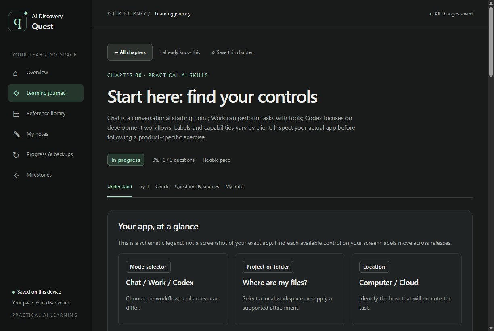

# AI Discovery Quest

**Learn to use AI through practical exercises—not just explanations.**

A beginner-friendly Windows desktop course with hands-on chapters, practice questions, searchable reference, and personal notes and progress. Start with a guided app tour, then explore models, tools, skills, memory, files, research, browsers, coding, GitHub, agents, and automation.

[**Download for Windows x64**](https://github.com/Mahmoud-Draidi/ai-discovery-quest/releases/latest) · [Release notes & checksums](https://github.com/Mahmoud-Draidi/ai-discovery-quest/releases/latest) · [Course guide](COURSE-GUIDE.md) · [Contribute](CONTRIBUTING.md)

Free and open source under the [MIT License](LICENSE).

## Download and start learning

1. Open the latest release and download its **Windows x64 app ZIP**: [Download for Windows](https://github.com/Mahmoud-Draidi/ai-discovery-quest/releases/latest).
2. Extract the **entire ZIP** to a folder; keep its files together.
3. Open **AI Discovery Quest.exe**.
4. Select **Learning journey**, choose a chapter, and follow **Understand → Try it → Check**.

You do **not** need Node.js, developer tools, or an API key to use the downloaded app. GitHub's **Source code** ZIPs are for developers; learners should use the Windows app ZIP above.

**Current release:** an unsigned Windows x64 app ZIP, without an installer or automatic updates. Windows may show an unrecognized-publisher notice. macOS and Linux downloads are not provided. Read the release notes before replacing an older version.

## How you learn

- Short explanations followed by practical tasks in real AI tools.
- Ready-to-use prompts, clear preparation, and checks for inspecting the actual result.
- Scenario knowledge checks with choice-specific feedback and reviewed retries.
- A compact, optionally always-on-top companion for practice alongside another app.
- Visible prerequisites and next-chapter links; a field guide and tracker project connect the work.
- Direct practice-step navigation, with separate skipped/deferred records so a missing feature does not block exploring another step.
- Personal chapter notes, bookmarks, a saved resume point, and earned milestones.
- Searchable answers and official references for revisiting a topic.
- Optional follow-up tasks, plus separate records for prior experience, skipped work, and missing preparation.

The app guides your practice. Exercises use the relevant AI chat, browser, file tool, coding assistant, or connected service. Those tools may need an account, connection, or runtime; each chapter explains its preparation. Bundled lessons, quizzes, and personal progress work offline. External practice and source links may need internet access.



## Explore the course

| Start here | Build confidence | Go further |
|---|---|---|
| App tour and safe setup | Research with evidence | Develop with AI and Git |
| Models, tools, and skills | Maps, images and interface features | Tracker workflow capstone |
| Memory and account boundaries | | |
| Files, context, and continuity | Create useful artifacts | Collaborate through pull requests |
| Ask, steer, and verify | Show AI what you see | Local, worktree, and cloud |
| | Plugins, MCP, and reusable skills | Subagents and coordinated chats |
| | Plans, goals, schedules, and chat controls | Hooks and cross-product workflows |

[Read the course guide](COURSE-GUIDE.md) for chapter preparation and practice checkpoints. Optional follow-ups are task cards rather than additional full chapters. Product features vary by account and client; unavailable practice can be deferred.

## Your notes and progress

Everything is saved locally on your computer. On Windows, the app uses:

```text
%APPDATA%/AI Discovery Quest/progress.json
```

- **Continue where I left off** returns to the saved chapter, section, and step.
- **Progress & backups** lets you record existing experience and export/import a personal backup.
- Import previews the replacement and keeps a local recovery copy.
- Your notes and resume point are not uploaded to this repository or included in the app download.

Different extraction folders can share the same Windows account's progress. Back up before updating, close the old app first, and avoid running older and newer versions against the same data. Notes and backups are plain text, not encrypted or automatically synced; keep them private.

Practical completion is your report of work in another tool. The app does not observe your external chats. Existing-experience records do not fabricate quiz results or automatically award a milestone.

Skipped and deferred steps remain unfinished; they do not satisfy practical completion. Returning and checking a step clears its earlier deferred/skipped status. This source adds separate shortcut and reusable-assistant tasks after the existing feature-lab steps. Existing checks and notes stay saved, but the expanded chapter needs those additional checks before it is complete. New source changes are not included in the downloadable ZIP until a new release is published.

## For developers

Contributions to lessons, usability, accessibility, tests, and tool guidance are welcome. See [CONTRIBUTING.md](CONTRIBUTING.md). Fork the project, work on a feature branch, and open a pull request.

### Run from source

Use Node.js 24 and pnpm. Electron 45.0.0 and dependencies are pinned in the lockfile.

```sh
git clone https://github.com/Mahmoud-Draidi/ai-discovery-quest.git
cd ai-discovery-quest
pnpm install --frozen-lockfile
pnpm start
```

Installation may need internet to obtain dependencies and the official Electron runtime. The optional Windows `Launch Learning Hub.cmd` is a development launcher, not an installer.

### Test and build

```sh
pnpm test
pnpm build:win
```

The Windows x64 build command produces the runnable ZIP, source/build metadata, and `SHA256SUMS.txt` in ignored `dist/`. It refuses to overwrite an existing generated build folder. Source packaging excludes personal data, Git history, tests, and development dependencies while retaining runtime license notices.

GitHub Actions runs syntax and content/progress/storage tests on Windows and Linux. Desktop interaction, restart, and extracted-app checks are separate QA; CI alone does not prove every external exercise works.

### Source map

| Path | Purpose |
|---|---|
| `src/content.js`, `src/course.js` | Lessons, practice prompts, questions, and reference content |
| `src/renderer.js`, `src/course-ui.js` | Desktop course screens and interactions |
| `src/state.js`, `src/store.cjs` | Progress normalization, completion gates, and local storage |
| `src/main.cjs`, `src/preload.cjs` | Electron window and restricted desktop interface |
| `tests/` | Content, persistence, compatibility, and completion checks |
| `scripts/package-windows.cjs` | Windows ZIP packaging |

The renderer is sandboxed with context isolation and no Node integration. No production framework or built-in AI API is required. [Chapter sources](CHAPTER-SOURCES.md) document editorial provenance and reference checks. The [changelog](CHANGELOG.md) summarizes releases.

## Feedback and license

[Report a bug or suggest an improvement](https://github.com/Mahmoud-Draidi/ai-discovery-quest/issues). Include the app version and reproducible steps; omit private notes, credentials, and personal progress files.

Original source and course documentation use the [MIT License](LICENSE). You may use, modify, and redistribute them, including commercially, while preserving the required notice. Dependencies retain their own licenses. Contributions back are welcome, not required.


### Maintainer content and desktop checks

Run `node scripts/generate-course-guide.cjs` after editing lesson metadata. `node scripts/generate-course-guide.cjs --check` verifies that the guide matches the course.

Optional desktop QA uses an existing Playwright installation: set `QUEST_PLAYWRIGHT` to its module path, or make `playwright` available to Node, then run `node scripts/verify-desktop.cjs`. It launches a separate test profile under ignored `test-results/`, tests interaction and companion-window behavior, and closes its windows. It does not modify the real learner profile.

See [review response](REVIEW-RESPONSE.md) for changes and limitations. New source features may not yet be in the latest downloadable release; check release notes for the shipped version.
