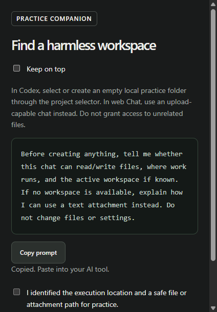

# Learner review response

## Files and memory follow-up

The memory lesson now provides the scope comparison it previously asked learners to create unaided, with a direct practice-to-table link and official references. Both continuity lessons show expected results and recovery guidance. A copyable fictional handoff supplies all its own inputs, while the personal progress prompt waits for confirmation of actual actions. Context-quiz retries explain each mistaken assumption directly. These additions preserve existing exercise and accepted-answer IDs without awarding new completion credit.

## Follow-up learner-flow improvements

The setup practice now supplies a concrete screen-inventory example and a direct control-map link. Curated chapters and the context chapter let learners navigate between steps without recording false completion. Each step can retain its own skipped/deferred status across reloads; checking actual work clears that status. The final practice gate still requires every check.

The compact companion adds bounded Next, chapter-note and return actions. The primary window remains the only progress writer, and stale step keys cannot navigate or change notes. Notes open in the primary editor rather than a second unsynchronized editor.

Existing feature-lab step positions are retained, with separate shortcut and reusable-assistant practice appended. These new tasks begin unfinished even for previously completed profiles. Git exercises now add a remaining-count summary and then a distinct `--pending` option, instead of requesting behavior the starting tracker already has. Automated validation covers step-state persistence, unearned completion, reloads, companion navigation and stale actions. No external product execution or new packaged release is implied by these checks.

The submitted review was based on source inspection, not a desktop run. This change checks its findings against the current source and adds desktop interaction checks.

| Finding | Response |
|---|---|
| Missing starting orientation | Adds an introductory setup chapter and schematic control map, including modes, model/effort, folder/attachment routes, local/cloud, approvals, menus and shortcuts. It is a legend, not a screenshot of a particular app version. |
| Missing README/snapshot sentence and historical wording | The preceding merged change supplied these inputs and removed several history references. This branch preserves them, fixes remaining numbered cross-references, and broadens wording checks. |
| Hidden dependencies | Shows prerequisites on cards and in chapter preparation, with links. Tracker/README dependencies use stable topic names; equivalent work is allowed. |
| Thin memory and feature coverage | Adds memory/account scope practice and a feature lab for public maps, images, reusable assistants, interface shortcuts, private credential handling and hosted-browser inspection. Unsupported features can be deferred. No credentials or account settings are changed by the course. |
| Easy quizzes | Replaces implausible distractors, adds scenario framing and choice-specific feedback, and asks learners to review feedback before retrying. Retry completion is formative learning, not a certified independent assessment. Existing correct-answer indices stay compatible. |
| Missing next route | Adds next-chapter preparation links, uses course-wide nextAction on Overview, and removes the duplicate first-chapter progress section. |
| Context switching | Adds an optional always-on-top compact practice companion with bounded IPC, synchronized current-step checks, stale-step rejection and a single progress writer. |
| Interface clarity/accessibility | Adds visible copy/save notices, readable label sizes, checkbox/quiz focus recovery, keyboard tab navigation, consistent Questions & sources, a milestone grid, human-readable statuses, deduplicated sources, and topic filters. Existing-experience records are collapsed by default under Progress & backups. |
| Product comparisons | Adds task-specific In other tools references throughout the route, including CLAUDE.md, Copilot repository instructions, MCP, subagents, hooks and Claude Code checkpointing. No one-to-one feature parity or paid-product practice is claimed. |
| Disconnected micro-exercises | Makes the field guide and learning tracker the project thread; adds a tracker capstone through plan, isolation, delegation, PR/review and actual scheduled-run inspection. Building/releasing the learning app remains separate project work. |
| Dates and maintenance | References derive their content-review date from chapter metadata. Dates do not imply each external feature was executed. The course guide is generated from content, and tests check that it stays current. |

## Scope and evidence

Existing chapter IDs, quiz answer mappings, saved notes, records and resume fields remain compatible. New topics start unfinished and may change aggregate progress; importing old records does not manufacture completion. Personal profiles are not bundled or committed.

External-product exercises still run in the learner's chosen AI tools, not in an embedded coach. Maps and images are not simulated inside the learning app. The Passwords feature label could not be established as a universal setting in current documentation; the lesson teaches safe inspection and private sign-in rather than inventing a control.

Official source checks on 26 October 2026 included OpenAI mode/environment, project, memory, settings, plugins, Pets and browser documentation; Claude Code overview, extensions, memory, subagents, hooks and checkpointing; and GitHub Copilot repository instructions, agent/review workflows and MCP. Exact links are in the bundled sources and CHAPTER-SOURCES.md. This is documentation validation, not a claim of hands-on execution in every product.

Run the Node tests and optional desktop QA before merging. No release is created by this branch.

## Verification performed

- All 20 Node tests passed, including saved-progress storage, independent legacy answer mappings, new-topic isolation, route prerequisites, feedback coverage, comparison source references, and generated-guide consistency.
- The isolated Electron desktop check passed: app tour, chapter tabs/routes, next links, visible copy confirmation, checkbox/quiz focus, arrow-key tabs, reviewed quiz retries, reference search/topic filters, optional existing-experience shortcut, milestone grid, narrow layout, and saved-note reload.
- Companion tests verified copy feedback, optional always-on-top state, bidirectional current-step checkbox updates, stale-step rejection, and the absence of the primary window's progress API in the companion.
- Screenshots below use a fresh test profile. The real learner profile and private continuation file were untouched.
- No updated packaged ZIP, clean-machine installation, or paid competitor execution is claimed. Existing downloadable release remains unchanged.

