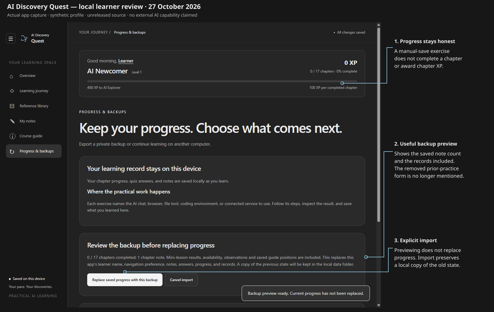

# Fresh learner review — 27 October 2026

Local source review; not a published release or proof of completed learning.

## What was actually tested

I used a clean synthetic profile with Windows/Chat/new learner selected and file writing recorded unavailable. I read the screens, chose the missing-control route, encountered a collapsing-help bug, fixed it, and continued via the supplied-text practice link. I saved and read a short three-definition note in the review folder, recorded that this was the local manual-save fallback, and kept external file-writing unverified.

I wrote a chapter note, looked up Token beside the task, fully closed the app, reopened the same profile and resumed the saved note section. With the renderer context set offline, bundled lessons, images, definitions and saved records still loaded. System networking was not disabled. External reference links still require internet access.

I reviewed an unavailable image activity as a fallback, browsed a model-handoff guide, exported a real backup through the app, temporarily edited the note and restored the backup through its preview/confirmation flow. The restored record retained the note, single recorded practical check, unavailable/fallback status, observations and guide selection/position. The import also preserved a pre-import copy locally.

The review ended with **zero completed chapters and zero XP**. The test artifact is not a live ChatGPT Plus exercise, and reading a worked example did not activate or complete its external workflow. Personal learner progress was untouched.

## Findings fixed locally

1. Missing-control help closed after the first Not found action, hiding the second control. Recording labels now updates the fields and prepared message without closing the help. A direct supplied-text practice link makes recovery actionable.
2. Backup previews still counted prior-practice records after that form was removed. The preview now shows completed chapters and saved chapter notes and names the newer records carried by the backup.
3. README download instructions referred to unreleased starting-point setup. Published-version instructions now use Learning journey, and source-only improvements are explicitly identified as unreleased.
4. Release packaging copied the whole runtime source folder and read Git state only afterward. Preflight now requires the app's clean Git root and packages only tracked runtime files. Ignored notes/scratch files are excluded; tracked known private records and non-file runtime entries are rejected. Source is rechecked before creating a ZIP.

## Status against the earlier tables

| Earlier item | Current local status | Remaining work |
| --- | --- | --- |
| A1 / B8 — source versus download | Download/source wording separated; app revision shown; clean-source packaging gate added. | Choose an unused version after review, package from the intended clean commit, inspect/test extracted EXE, verify checksum, then publish only when requested. |
| A2 — first Windows lesson | Setup, illustrated controls, prepared observations and a concrete missing-control route exist. | Actual dated screenshot and a pilot using a specific supported Windows client; the illustration is explicitly not that screenshot. |
| A3 — opening overload | Only first-task controls appear upfront; full map is optional reference. | Validate with a human first-time learner. |
| A4 — mixed features | Independent mini-lesson entries/outcomes plus separate optional activities; old combined records preserved without inferred completion. | Old chapter route remains for stable XP/history; no claim that every capability was run. |
| A5 / B1 — unavailable features and next task | Per-step help/availability, exact revisit links and separate Resume/recommendation flow verified. | Broader account-specific usability testing. |
| A6 / B2 — practical format | All 60 chapter exercises provide inputs, expected result, failure and recovery. | External result checks on real tools/clients. |
| B3 — beginner vocabulary | Twenty searchable definitions beside lessons, with focus/scroll return. | Full accessibility audit beyond the keyboard/contrast spot checks. |
| B4 — Git/GitHub teaching | Seven-stage tracker example, real local Git fixture and recovery requests. | Real GitHub learner pilot with an explicitly chosen repository. |
| B5 — advanced workflows | Eight worked guides, concrete handoffs and locally tested starter/checker/defect/helper. | Actual agent/model/chat/cloud/schedule/lifecycle/browser runs on an available account/client. |
| B6 — other-tool comparisons | Generic section remains removed as requested. | No replacement comparison section planned. |
| B7 — coverage checklist | Course guide and generated inventory distinguish tutorial depth and account availability. | Keep labels synchronized with executed pilot evidence and the eventual shipped version. |

## Verification record

- **66 Node tests passed**, including migration, XP invariants, actual disposable Git behavior, workflow fixtures and release preflight.
- **Eight app verification suites passed**: desktop, first steps, practice guides, dashboard, mini-lessons, glossary/Git support, workflow labs and the cross-feature learner journey.
- Keyboard checks cover repeated arrow navigation and End across chapter tabs; definitions close with Escape and return focus. Contrast spot checks exceed 4.5:1 for selected body, caption and secondary-button text. This is not a full accessibility certification.
- Wide/narrow layouts and reduced-motion behavior remain covered by the existing suites.
- Generated course/coverage checks remain required before the release commit.

`verify-learner-journey.cjs` reproduces the cross-feature path. Its screenshots, exported backup, pre-import record, synthetic state and artifact remain in ignored `test-results/`. Only the annotated synthetic screenshot is included here. No personal progress or credentials are published.

## Release boundary

This downloaded workspace has no `.git` history. Release preflight correctly refuses it before copying runtime files. No version bump, release ZIP, checksum, PR, tag or publication was produced. Use a real checkout containing the reviewed changes for the release phase. The existing local preview remains separate from real learner data.
